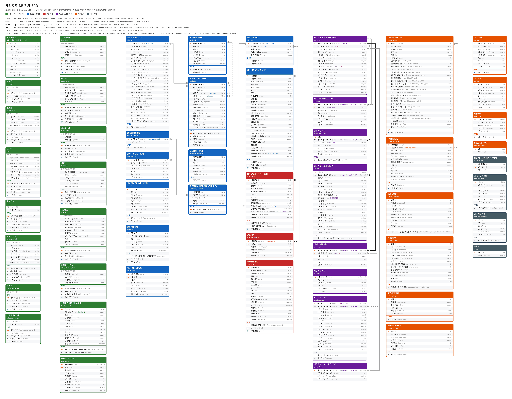

# 세잎지도 (safe-route)

[](https://github.com/Safe-Way/safe-route/actions/workflows/ci.yml)

**상황 인식 기반 안전 도보 경로 추천 서비스.** 어린이·노인·휠체어 사용자에게 가장 빠른 길 대신 **그 사람이 실제로 걸을 수 있고 안전한 길**을 골라 주고, 왜 그 길인지 쉬운 말로 설명합니다.
화면 조작이 어려운 분도 쓸 수 있게 "문화전당 가자"처럼 **말로 묻는 AI 비서**로 동작합니다.

- 서비스: https://safe-route.java21.net (학교 서버, `main`에 머지하면 자동 배포)
- 데이터 범위: 광주광역시 전체 · 시연 지역: 국립아시아문화전당 일대
- 앱: [safe-route-android](https://github.com/Safe-Way/safe-route-android) (안드로이드, Kotlin)
- 요구사항: [safe-route-docs](https://github.com/Safe-Way/safe-route-docs)의 [requirements.md](https://github.com/Safe-Way/safe-route-docs/blob/main/requirements.md) (결정 60건, 변경 이력 [CHANGELOG.md](https://github.com/Safe-Way/safe-route-docs/blob/main/CHANGELOG.md))
- 비서 설계 문서: [docs/assistant/](docs/assistant/) (동의 문구, 도구 고르기, 시험 질문, 사용성 점검표)
- 현장 비교 시험: [docs/field-test/](docs/field-test/2026-11-11.md) (11-11 우리 앱 vs 네이버·카카오 도보, 찾은 문제와 고칠 사람)

## 본선 발표 (조선대학교 2026 IT Festival · AI·SW 캡스톤디자인 경진대회)

| 자료 | 파일 |
|---|---|
| 발표 영상 (4분, 1080p) | [세잎지도_본선발표.mp4](docs/presentation/세잎지도_본선발표.mp4) |
| 발표 자료 (바로 보기) | [세잎지도_본선발표.pdf](docs/presentation/세잎지도_본선발표.pdf) |
| 발표 자료 원본 (발표자 노트에 키워드·대본) | [세잎지도_본선발표.pptx](docs/presentation/세잎지도_본선발표.pptx) |

발표 순서: 왜 만들었나 → 어떻게 길을 고르나 → 앱과 AI 비서 → 어떻게 시험하고 고쳤나 → 활용 방안과 팀 (19장부터 부록: 데이터·엔진·값 정하기·시험 방법)

## 결과 한눈에

| | 숫자 | 내용 |
|---|---|---|
| 안전 데이터 | **10만여 곳** | 공공데이터 약 550만 건을 정제해 광주 전체 걷는 길에 붙임 |
| 사용성 점검 | **9 → 21** (22항목 중) | 75세 어르신이 되어 앱을 지우고 처음부터 사용. 실패한 곳을 고친 뒤 2회차 (1개는 흐린 날만 확인) |
| 현장 비교 (11-13) | **세잎지도 0 · 카카오 8 · 네이버 10** | 같은 시간, 같은 코스를 세 앱으로 걸으며 센 계단·턱·인도 없음·차도 건넘·막힌 길 합계 (한 코스 결과) |
| 현장에서 고치기 | **5 → 2 → 0** | 세잎지도도 11일엔 5곳. 걸으며 찾은 문제를 고치고 12·13일에 다시 걸음 |
| AI 비서 | **입력 토큰 55%↓** | 83,385 → 37,583. 규칙으로 답할 말은 AI를 안 부르고, 필요한 도구만 보냄. 시험 문장 63개 중 맞게 동작 44 → 56 |

같은 출발·도착(휠체어·밤)에서 일반 최단 길과 세잎지도 길 비교 (11-17 실제 서버 값, 골목 = 인도 없는 골목):

| 출발 → 도착 | 일반 최단 | 세잎지도 | 달라진 것 |
|---|---|---|---|
| 문화전당 → 펭귄마을 | 1,115m | 1,211m | 골목 82 → 37m · 어두운 구간 3 → 2 |
| 문화전당 → 남광주시장 | 1,033m | 1,106m | 어두운 구간 2 → 0 · 가로등 +3 |
| 동명동 → 문화전당 | 806m | 867m | 골목 169 → 6m · 가로등 +12 |

현장 시험 뒤(11-14~16) 고친 것을 같은 요청으로 다시 잰 값:

| 항목 | 전 → 후 | 고친 방법 |
|---|---|---|
| 휠체어 · 문화전당 앞 → 금남지하상가 | 1,261m → 588m | 엘리베이터 있는 출구(문화전당역 3번)를 골라 그 출구에서 끝냄 |
| 휠체어 · 정류장 → 서석동 → 조선대 | 골목 340m → 9m | 국토지리정보원 인도 데이터로 인도 없는 골목을 빼고 큰 길 인도로 |
| 휠체어 · 문화전당역 5번 → 4번 출구 | 926m → 608m | 평지인 5·18민주광장 선을 휠체어도 쓰게 하고 공사 자리는 피함 |
| 길안내 중 신고가 길에 반영 | 최대 60초 → 바로 | 신고가 저장되면 다음 길찾기가 곧바로 피함 |
| AI 비서 답 기다리는 시간 | 최대 10초 → 7초 한도 | 7초를 넘으면 이미 찾은 장소·길로 바로 답함 |
| 서버 테스트 줄 커버리지 | 82.9% → 89.0% | 자동 테스트 891개, 데이터 적재 46% → 96% |

## 주요 기능

| # | 기능 | 내용 |
|---|---|---|
| 1 | 말로 묻는 비서 | 휴대폰이 말을 글자로 바꿔 서버 비서(`POST /api/assistant`)로 보냄. 급한 말·들를 곳·못 하는 일은 서버 규칙이 먼저 답하고, 나머지는 구글 제미나이가 장소 찾기·길 추천 같은 도구를 고름. 길·시간·거리 계산은 우리 서버가 함 |
| 2 | 모드별 맞춤 길 | 어린이·청소년, 노인, 휠체어, 기본(청년·중년). 휠체어는 계단·확인된 턱·못 지나는 육교를 빼고, 노인은 계단을 피하고 쉴 곳을 가깝게, 어린이는 지킴이집·CCTV가 많고 큰길을 덜 건너는 길 |
| 3 | 상황 판단 | 밤에는 가로등·CCTV가 많은 밝은 길, 비가 오면 지붕 있는 길과 지하 길(역 대합실·금남지하상가), 행사·공사·사고는 피함 |
| 4 | 이유 설명 | "계단 2곳을 피해 210m 더 가요"처럼 최단 길과의 차이를 말함. 대중교통은 "정류장까지 5분, 버스 12분, 내려서 3분"처럼 구간 순서대로 |
| 5 | 걷기와 대중교통 비교 | 걷기와 버스·지하철(저상버스 도착 포함)을 날씨·몸 상태·기록으로 비교해 하나를 추천. 들를 곳은 걷기 3곳·대중교통 1곳까지 |
| 6 | 신고된 곳 | 앱 사진 신고·말 신고를 같은 곳(같은 종류·30m)으로 묶어 1건부터 피함. 종류별 1·7·30일 유지, 끝난 신고·사진은 매일 정리 (결정 57·59). 인도를 막은 물건 신고의 사진을 서버의 작은 분류 모델이 보고 차·오토바이라고 95% 이상 확신하면 하루 대신 3시간만 피함 (차는 금방 빠지므로, 036) |
| 7 | 보호자 위치 공유·급한 말 | 마지막 한 점만 공유하고 도착하면 링크를 닫음. "누가 따라와" 같은 말에는 112·보호자·가까운 파출소 버튼 |
| 8 | 기억하기 | 로그인 없이 앱이 만든 무작위 번호로 모드·설정을 기억. 다닌 기록은 동의한 사람만 남기고 위치는 약 100m로 반올림 |

## 팀 (등불지기)

| 파트 | 이름 | 맡은 일 |
|---|---|---|
| A 데이터·DB · 기획(PO) | 김재휘 | 공공데이터 수집·정제, 광주 도로망·지하 길·광장 길, DB 설계, 요구사항 문서, CI/CD·배포, 비서 점검 |
| B 경로 엔진 | 정원일 | 모드별 비용과 A* 탐색, 우회 한도, 신고·비·지하 길 반영, 길 설명 문장 |
| C 서버 | 김채림 | API, AI 비서(제미나이 도구 호출·규칙·토큰 줄이기), 대중교통·버스 도착, 신고·보호자 공유 |
| D 앱 | 박민수 | 안드로이드 화면·지도·길안내, 말로 대화, 보호자 공유·신고 화면 |

조직: https://github.com/Safe-Way

## 구조

```
안드로이드 앱 ──(음성 인식·읽기는 휴대폰 기본 기능)
   │  HTTPS
   ▼
Spring Boot 서버 (학교 서버, 두 대가 번갈아 받음)
   ├─ /api/assistant   비서: 규칙 → 제미나이(도구 고르기) → 우리 도구가 계산
   ├─ /api/route       걷기 길찾기 ── 경로 엔진 (OSM 도로망 그래프, A*)
   ├─ /api/transit     대중교통 (ODsay, 광주 버스 도착)
   ├─ /api/reports     신고 (사진은 DB에, 사진 종류는 ONNX 분류 모델로 판단)
   └─ /api/places · /api/pois · /api/events · /api/guardian/shares · /api/me · /api/ai/* …
   ▼
MySQL 8 (공간 인덱스) — 시설·도로망·길별 점수·신고·내 정보
```

## 어떻게 길을 고르나

길 한 구간의 비용은 길이에 상황별 감점을 더해 계산합니다 (자세히: [docs/route-weights.md](docs/route-weights.md)).

```
비용 = 길이 × (1 + Σ 가중치(시간대·날씨·모드) × 감점)
```

- 감점 예: 어두움, CCTV 없음, 도움 받을 곳 멂, 계단, 큰 차도 횡단, 비포장, 신고된 곳
- 휠체어는 감점이 아니라 **뺍니다**: 계단(경사로 없는 것), 확인된 턱, 엘리베이터 없는 육교
- 최단 경로보다 너무 돌지 않게 상한을 둡니다: 기본·어린이 1.3배, 노인·휠체어 1.2배
- 비교 기준은 TMAP 도보 경로입니다 (카카오 도보 API는 제휴사 전용)

## 기술 스택

| 구분 | 사용 |
|---|---|
| 서버 | Java 21, Spring Boot 4.1, Maven, JGraphT(A*) |
| DB | MySQL 8 (공간 인덱스, `ST_Distance_Sphere`, 뷰) |
| AI | Google Gemini (함수 호출). 규칙으로 답할 수 있는 말은 부르지 않고, 필요한 도구만 보내 입력 토큰 약 55% 줄임 |
| 신고 사진 분류 | PyTorch로 MobileNetV3-Small 학습(`ml/report_photo/`) → ONNX(6MB) → 서버는 ONNX Runtime(Java)으로 판단 |
| 앱 | Android (Kotlin, Jetpack Compose, 카카오맵 SDK) |
| 외부 API | 카카오 로컬(장소), 기상청·에어코리아, ODsay(대중교통), 광주 버스 도착, TMAP 보행자(비교용) |
| 도로망 | OpenStreetMap (광주 81,709구간) |
| 배포 | GitHub Actions → Docker → 학교 서버 (`main` 머지 = 배포, 서버 상태 감시) |
| 데이터 스크립트 | Python 3 (표준 라이브러리만) |

## 데이터

광주 길찾기에 쓰는 정제 시설과 도로망 (2026-11 기준):

| 데이터 | 건수 | 쓰는 곳 |
|---|---|---|
| 가로등·보안등 | 85,754 | 밤 밝은 길 |
| CCTV (단속용 뺌) | 4,514 | 밤·어린이 길 |
| 쉼터 · 화장실 · 비상벨 | 2,936 · 1,205 · 219 | 노인 쉴 곳, 도움 받을 곳 |
| 횡단보도 | 3,539 | 신호·보도턱 |
| 지하철 출구 엘리베이터 | 92곳 확인 | 휠체어 대중교통 |
| 도로망 (OpenStreetMap) | 81,709구간 | 경로 엔진. 자동차전용도로는 빼고, 지하 길·보행자 광장 길을 따로 보관 |
| 인도 (국토지리정보원) | 선 30,020 · 면 10,668 | 연속수치지형도 인도 선(폭·재질·종류)과 국가기본도 보도경계면. 우리 길 60,586개에 옆 인도·폭·재질을 붙임(`edge_sidewalk`, 034) |
| 1:1,000 수치지도 (국토지리정보원, 시연 지역) | 계단 · 횡단보도 · 신호등 · 인도 폭 | `load_ngii_1000.py`. 계단 14구간(683m, 현장 확인으로 3구간 뺌), 면 횡단보도 633 → 1,226, 신호 여부를 아는 횡단 61% → 83%, 인도 폭 2,718곳. 등고선·표고점은 잡음이 커서 경사에는 안 씀 |

전국 원본 (처음 받은 것):

| 데이터 | 출처 | 건수 |
|---|---|---|
| 가로등 · 보안등 · 경찰 | 재난안전데이터 공유플랫폼 (행정안전부 공통POI) | 보안등 약 95만, 가로등 약 225만 |
| 보안등 | 공공데이터포털 전국보안등정보표준데이터 (지자체 직접 등록) | 약 186만 |
| 한파쉼터 | 재난안전데이터 공유플랫폼 (DSSP-IF-10804) | 약 5.4만 |
| CCTV | 행정안전부 지방행정 인허가 데이터, 광주광역시 | 약 39만 |
| 비상벨 · 편의점 · 지킴이집 · 무더위쉼터 · 공중화장실 | 생활안전지도 | 약 26만 |

생활안전지도 데이터는 **공공누리 4유형**(출처표시 · 상업적 이용 금지 · 변경 금지)입니다.

신고 사진 분류 모델은 AI Hub **인도보행 영상**(한국지능정보사회진흥원, dataSetSn 189)의 상자·면 라벨로 사진 조각을 잘라 학습했습니다. 원본은 git에 올리지 않습니다.

| 모델 | 처음 보는 장소 사진 8,470장 | 기준 0.95에서 진짜 차량 잡음 | 막는 물건 2,550장 중 차량으로 봄 |
|---|---|---|---|
| v4 | 정확도 92.0% · 공사 63% | 68% | 3장 |
| **v6 (서버 사용, 11-20)** | 정확도 93.1% · 공사 76% | **75%** | 15장 (대부분 차가 주인공인 사진, 진짜 오판 4~5장) |

v6는 차·오토바이가 크게 덮은 '막는 물건' 학습 사진을 빼고 학습했습니다. 모델이 확신하지 못하면(95% 미만) 예전처럼 하루 피합니다.

## DB 표

원본 시설은 종류마다 표 하나씩 있습니다. 길찾기는 이를 정제한 `poi`·`edge_stat`(길별 점수)·`edge_poi`(길별 주변 시설)를 씁니다. 표 정의의 원본은 `db/schema.sql`이고, 그림 파일은 [docs/erd](docs/erd)에 있습니다.

전체 ERD (표 52개, 2026-11-24 Flyway V41 기준). 표와 칸마다 논리명(한글 뜻)과 물리명(DB에 쓰는 이름)을 적고, 표 아래에 적용한 인덱스(유니크·일반·공간·전문 108개)를 적었습니다. 관계선은 IE 표기입니다: 실선 = 식별 관계(부모 키가 자식 PK에 들어감), 점선 = 비식별 관계, 양 끝은 세발 표기(꼭 하나 · 없거나 하나 · 없거나 여러 개). 진한 선은 DB의 실제 외래 키(4개), 회색 선은 같은 값으로만 이어진 관계입니다. 게스트 표들은 앱이 처음 실행 때 만든 무작위 번호(UUID, 36글자) `guest_id`로 이어지고, 신고에는 이 번호의 HMAC만 남깁니다. 영문·숫자만 담는 칸(게스트 번호·토큰·코드)은 `ascii`로 대소문자를 구별하고, 모드 칸은 `CHECK`로 네 값만 받습니다.

[](docs/erd/safe_route_full_erd.png)

아래는 시설 원본 표입니다. 모든 표에 공통 칸이 있고, 종류마다 필요한 칸이 붙습니다.

| 표 | 내용 | 종류별 칸 |
|---|---|---|
| `streetlight` | 가로등 | |
| `security_light` | 보안등 | `lamp_count`, `install_year`, `manager`, `manager_phone` |
| `cctv` | CCTV | `camera_count`, `pixels`, `direction`, `retention_days`, `installed`, `manager_phone` |
| `police` | 경찰서 · 지구대 · 파출소 등 | `phone` |
| `emergency_bell` | 안전 비상벨 | `purpose`, `police_linked`, `manager`, `manager_phone`, `last_inspected` 등 |
| `convenience_store` | 편의점 | |
| `child_safety_house` | 아동안전지킴이집 | `phone` |
| `heat_shelter` | 무더위쉼터 | `capacity`, `area_m2`, `night_open`, `weekend_open` |
| `cold_shelter` | 한파쉼터 | `capacity`, `weekday_hours`, `saturday_hours`, `sunday_hours`, `holiday_hours`, `note` |
| `public_toilet` | 공중화장실 | `phone`, `open_hours` |
| `facility_all` (뷰) | 위 표 전체를 공통 칸만 모아 보기 | |
| `data_source` | 출처별 적재 현황 (건수, 이용 조건, 받은 날) | |

- **공통 칸:** `kind`(세부 종류), `source`, `source_id`, `name`, `address`, `sido_code`, `sgg_code`, `lon`, `lat`, `geom`, `attrs`
- **인덱스:** 위치(`geom` 공간 인덱스), 출처, 세부 종류, 시군구 코드, 주소·이름 앞부분

```sql
-- 문화전당 주변 지구대·파출소
SELECT kind, name, phone, address FROM police
WHERE MBRContains(ST_GeomFromText('POLYGON((126.91 35.14, 126.93 35.14, 126.93 35.155, 126.91 35.155, 126.91 35.14))'), geom)
  AND kind IN ('지구대', '파출소');

-- 문화전당 500m 안 시설 수
SELECT type, COUNT(*) FROM facility_all
WHERE ST_Distance_Sphere(geom, POINT(126.9204, 35.1466)) < 500 GROUP BY type;
```

## 실행 방법

### 1. 설정 파일 만들기

`.env.example`을 복사해 `.env`를 만들고 빈 값을 채웁니다. 키와 DB 비밀번호는 팀 채팅으로 받습니다.
**`.env`는 git에 올리지 않습니다.**

```bash
cp .env.example .env
```

- 기본은 **학교 DB**입니다.
- 학교 밖에서는 `.env`에서 학교 DB 세 줄을 주석 처리하고 로컬 MySQL 세 줄을 풀어서 씁니다.

### 2. DB 표 만들기

학교 DB에는 이미 표와 데이터가 있습니다. 로컬 MySQL을 새로 쓸 때만 실행합니다.

```bash
mysql -u safe_route -p safe_route < src/main/resources/db/schema.sql
```

**표를 바꿀 때 (Flyway, 2026-11-23부터)**

- `src/main/resources/db/flyway/`에 `V37__무엇을_하는지.sql`처럼 다음 번호로 새 파일을 만들고, `schema.sql`도 같은 내용으로 고칩니다. 이미 머지된 V 파일은 고치지 않습니다.
- main에 머지되면 배포 때 앱이 뜨면서 학교 DB에 적용합니다(`FLYWAY_ENABLED=true`는 배포에서만). 학교 DB는 처음 한 번 "36까지 적용됨"으로 표시만 합니다(001~036은 손으로 적용해 둠, `db/migration/`에 기록으로 남김).
- 로컬은 기본이 꺼짐입니다. `.env`가 학교 DB를 가리키므로, 기능 브랜치를 띄우기만 해도 머지 전 변경이 학교 DB에 들어가는 일을 막습니다.
- CI는 빈 MySQL에 V 파일을 차례로 적용하고, `schema.sql`이 그 결과와 같은지 `scripts/check_schema_sync.sh`로 확인합니다.

### 3. 데이터 내려받기

API마다 하루 호출 한도(1,000번)가 있어서, 가로등처럼 큰 데이터는 며칠에 걸쳐 받습니다.
이미 받은 쪽은 건너뛰므로 다시 실행해도 됩니다.

```bash
python3 scripts/download_national.py          # 전부
python3 scripts/download_national.py police   # 하나만
python3 scripts/download_national.py --wait   # 한도가 차면 다음 날까지 기다렸다 이어 받기
```

CSV로만 받는 파일은 직접 내려받아 넣습니다.

- `data/raw/national/cctv_national.csv`
- `data/raw/regional/gwangju_cctv.csv`
- `data/raw/regional/donggu_security_light.csv`

### 4. DB에 넣기

```bash
./mvnw spring-boot:run -Dspring-boot.run.profiles=import
./mvnw spring-boot:run -Dspring-boot.run.profiles=import -Dspring-boot.run.arguments=--types=cctv,police
```

같은 종류를 다시 넣으면 지우고 새로 넣으므로 여러 번 실행해도 됩니다.

### 5. 한 번에 갱신하기 (FR-08)

3·4번과 좌표 고치기, 대중교통, 길 점수 계산까지 16단계를 정해진 순서로 한 번에 돌립니다(광주).

```bash
python3 scripts/refresh_data.py --dry-run       # 할 일 목록만 보기
python3 scripts/refresh_data.py                 # 전부: 받기 → 넣기 → 계산
python3 scripts/refresh_data.py --only compute  # 길 점수만 다시 계산
python3 scripts/refresh_data.py --from load     # 받기는 건너뛰고 넣기부터
python3 scripts/refresh_data.py --fresh crosswalk  # 이 데이터는 처음부터 다시 받기
python3 scripts/refresh_data.py --roads         # OSM 도로망도 다시 받기 (수십 분)
```

명령 하나로 돌리면 좋은 점

- **순서를 외우지 않아도 됩니다.** 데이터 스크립트들은 앞뒤가 얽혀 있습니다.
  - 대중교통을 다시 넣으면 손으로 확인한 출구 엘리베이터 값이 비어서, 바로 뒤에 `subway_entrance_elevator.sql`을 넣어야 합니다.
  - 정제 시설(`poi`)을 다시 만들면 id가 바뀌어서, 길별 주변 시설(`edge_poi`)을 그 뒤에 다시 만들어야 합니다.
  - 하나라도 빠뜨리면 지도와 경로에 틀린 값이 나옵니다. 이 명령이 그 순서를 지킵니다.
- **누가 돌려도 결과가 같습니다.** A파트가 없어도 팀원 누구나 시연 전에 최신 데이터로 맞출 수 있습니다.
- **끝나면 스스로 점검합니다.**
  - 길마다 원값이 있는지, 없는 길·시설을 가리키는 줄이 없는지, 확인 안 된 지하철 출구가 없는지, 같은 원본이 두 번 들어갔는지 봅니다.
  - 주요 표 22개의 줄 수를 지난번과 비교합니다. 줄 수가 같으면 중복 없이 같은 결과이고, 달라졌으면 새 원본이 들어왔거나 무언가 빠진 것입니다.
- **실패하면 멈추고 이어서 돌립니다.** 실패한 단계의 기록이 `data/raw/refresh_logs/<시각>/`에 남습니다. 고친 뒤 `--from <단계>`로 이어 돌립니다.
- **두 사람이 동시에 돌리지 못합니다.** 돌고 있으면 `data/raw/refresh.lock`이 있어서, 두 번째 실행은 바로 멈춥니다.

서버는 길찾기 요청마다 DB를 읽으므로, 갱신이 끝나면 서버를 다시 띄우지 않아도 반영됩니다.
도는 동안에는 경로가 "확인 안 됨"으로 나올 수 있으니 시연·테스트가 없을 때 돌립니다.
직접 받는 CSV(위 3번 목록, 공중화장실 CSV, `data/raw/regional/` 광주 CSV)는 새 파일로 바꿔 둔 뒤 돌립니다.

### 6. 테스트

```bash
./mvnw test
```

## 폴더 구조

```
src/main/java/com/saferoute/
  assistant/   비서 (규칙, 제미나이, 도구, 들를 곳)
  route/       걷기 길찾기와 경로 엔진 (engine/: 그래프·A*·점수·설명)
  transit/ bus/ subway/   대중교통·버스 도착·지하철
  report/      신고와 매일 정리
  guardian/    보호자 위치 공유
  me/          내 정보·이동 기록 (동의한 사람만)
  place/ facility/ event/ situation/ weather/ air/ walk/ tmap/   장소·시설·행사·날씨·미세먼지·외부 API
  appchat/     앱 화면 AI를 서버가 대신 부르는 창구
  ingest/      공공데이터를 종류별 시설 표로 옮기는 코드
src/main/resources/
  application.yml   설정 (키는 .env에서 읽음)
  route.yml         모드별 가중치·우회 한도
  db/schema.sql     DB 표 전체 (V 파일과 같게 유지, CI가 확인)
  db/flyway/        Flyway 변경 파일 (V36__baseline = 036까지 표 전체, 새 변경은 V37__부터)
  db/migration/     손으로 적용하던 변경 기록 (001~036)
  models/report_photo/  신고 사진 분류 모델 (model.onnx, labels.json)
docs/
  assistant/        비서 설계 (동의 문구, 도구 고르기, 시험 질문 41개, 사용성 점검표)
  route-weights.md  가중치 기준
  erd/              ERD (전체 그림 safe_route_full_erd.png, 다시 그리기 full_erd.py)
  field-test/       현장 비교 시험 기록
  presentation/     본선 발표 영상·자료 (mp4, pdf, pptx)
ml/report_photo/    신고 사진 분류 학습 (make_crops.py 사진 자르기, train.py 학습·ONNX 내보내기)
scripts/            데이터 받기·넣기·점검 스크립트 (refresh_data.py, eval_assistant.py, review_reports.py …)
data/raw/           내려받은 원본·점검 기록 (git에 올리지 않음)
```

## 배포와 앱 업데이트 안내

- `main`에 머지하면 CI(`ci.yml`) 시험이 통과한 뒤 `deploy.yml`이 학교 서버에 배포합니다. 필요한 Secrets 이름은 `deploy.yml` 맨 위에 있습니다.
- 앱은 켤 때 `GET /api/app/version?versionCode=<앱 번호>`로 새 버전이 있는지 묻습니다. 서버는 `update`를 `required`(꼭) · `optional`(나중에 가능) · `none` 중 하나로 답합니다.

| 설정 | 어디서 바꾸나 | 지금 값 |
|---|---|---|
| 최신 앱 번호 `APP_LATEST_VERSION_CODE` | `application.yml`의 `app-update` | 176 (앱 CI 실행 번호 = versionCode) |
| 꼭 바꿔야 하는 번호 `APP_MIN_VERSION_CODE` | `application.yml`의 `app-update` | 1 (막는 앱 없음) |
| 내려받을 주소 `APP_DOWNLOAD_URL` | GitHub **Variables** `APP_DOWNLOAD_URL` (Settings → Secrets and variables → Actions → Variables) | 팀 텔레그램 채널 |

- 내려받을 주소가 비어 있으면 업데이트 창이 뜨지 않습니다.
- 새 APK를 낼 때는 APK를 채널에 올리고, `APP_LATEST_VERSION_CODE`를 그 번호로 올려 `main`에 배포합니다.

## 점검

```bash
./mvnw test                                   # 서버 테스트
python3 scripts/eval_assistant.py             # 학교 서버 비서에 시험 질문 41개 (저장되는 질문은 --write일 때만)
python3 scripts/check_report_active.py        # 신고 기간 규칙 시험 (DB에 안 넣고 계산만)
python3 scripts/check_report_retention.py     # 신고 보관 규칙 시험
python3 scripts/review_reports.py             # 새 신고·사진 확인, --hide로 숨기기
```

앱·서버 연결 검사: 앱 저장소 [safe-route-android](https://github.com/Safe-Way/safe-route-android)의 `contract.yml`이 매일 오전 9시 10분에 운영 서버 응답 11개를 받아 앱 코드로 읽어 봅니다. 앱이 읽는 이름(약 150개)이 빠지거나 값이 이상하면 `contract-broken` 이슈가 열립니다.

외부 API 사용량: `GET /api/usage`가 오늘 제미나이·카카오·ODsay 호출 수(서버 두 대 합)와 하루 한도를 보여 줍니다. `health.yml`이 30분마다 읽어 한도의 80%를 넘으면 `usage-high` 이슈를 열고, 내려가면 닫습니다. 한도는 `GEMINI_DAILY_LIMIT`(기본 1000)·`KAKAO_DAILY_LIMIT`(기본 100000)·`transit.odsay-daily-limit`(30)로 맞춥니다.

매일 기록 정리(새벽 4시 40분, `me/RecordCleanup`): 비서가 못 한 요청 90일, 1년 동안 안 쓴 게스트(토큰 마지막 확인 기준, "내 기록 지우기"와 같은 코드), ODsay 호출 수 30일, API 호출 수 90일이 지나면 지웁니다. 신고는 4시 30분 정리(결정 59)가 따로 합니다.

DB 백업: 서버 cron이 매일 03:30 사람 기록 표, 매주 일요일 04:10 전체를 `~/safe-route/backup/`에 뜬다(`deploy/backup_db.sh`). 주 1회 노트북으로 복사(`scripts/pull_backup.sh`), 한 달에 한 번 되살려 보기(`scripts/check_backup.sh`). 자세히는 [docs/backup.md](docs/backup.md).

## 진행 상황

- [x] 공공데이터 수집·정제, 광주 도로망 (지하 길·광장 길 포함)
- [x] 경로 엔진: 모드별 길, 밤·비·행사·신고 반영, 이유 설명
- [x] 서버 API와 학교 서버 자동 배포
- [x] 안드로이드 앱: 지도·길안내·말로 대화·보호자 공유·신고
- [x] AI 비서: 규칙 + 제미나이 도구 호출, 토큰 줄이기, 매일 점검
- [x] 대중교통·저상버스, 들를 곳(경유지)
- [x] 사용성 점검 (어르신 모드, 1회차 9 → 2회차 21 / 22)
- [x] 현장 비교: 카카오·네이버와 같은 코스를 걸으며 비교하고 고치기 (11-11~13, 문화전당 일대)
- [x] 국토지리정보원 인도·1:1,000 수치지도 반영, 엘리베이터 출구 안내
- [x] 본선 발표 ([영상·자료](docs/presentation/))
- [x] 신고 사진 차량 판단 (MobileNetV3, v6) → 차가 막은 길은 3시간만 피하기
- [x] 앱·서버 연결 자동 검사 (매일 아침)
- [x] 앱 업데이트 안내 창 (`GET /api/app/version`, 최신 176)
- [ ] 인도 폭·재질로 좁은 인도 피하기 (지금은 폭을 안내에만 씀)
- [ ] 건물 출입구·엘리베이터 위치, 경사 데이터
- [ ] 실제 보행 약자와 함께 걷는 시험
- [ ] 실제 폰으로 찍은 신고 사진으로 사진 분류 모델 다시 확인
- [ ] 유모차 모드 (추후)

### 정직하게 밝히는 한계

- 턱 낮춘 횡단보도 데이터는 광주 296곳뿐입니다.
- 경사 데이터가 없고, 건물 출입구·엘리베이터 위치도 없습니다. 신고와 현장 확인으로 채우는 중입니다.
- 현장 비교는 문화전당 일대 한 코스 결과입니다.
