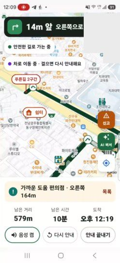
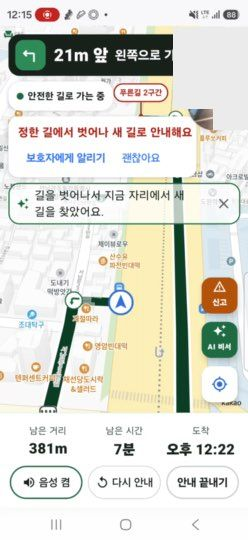
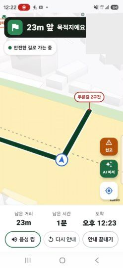
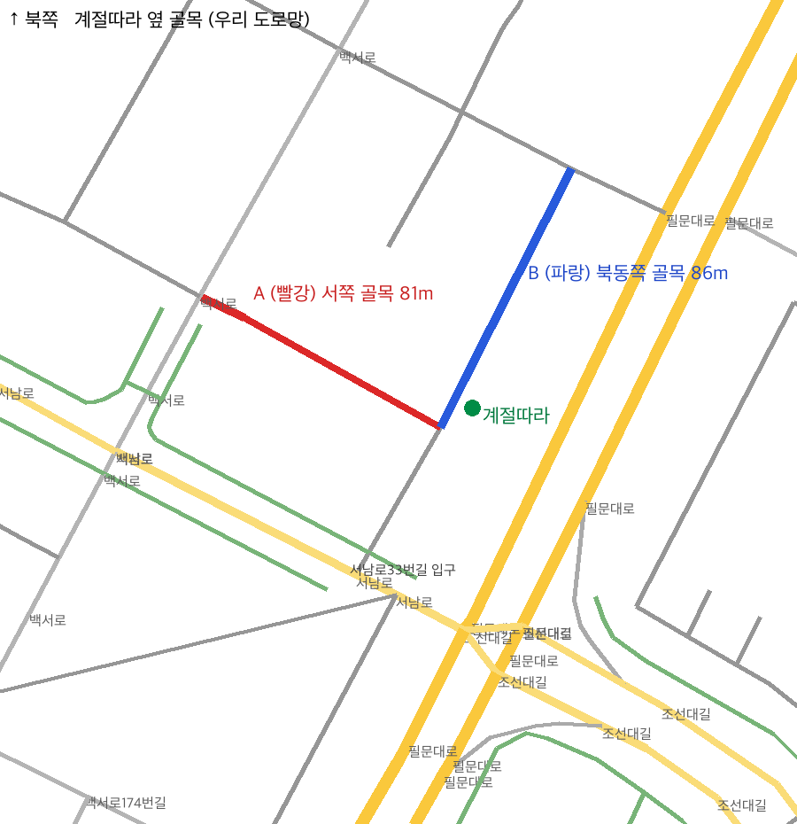

# 현장 비교 시험 (2026-11-11)

11-10 교수님 피드백("계산만 하지 말고 같은 길을 일반 길찾기 도보 모드와 우리 앱으로 직접 걸어 비교")에 따라
문화전당 일대 두 코스를 우리 앱과 다른 지도 앱으로 같이 걸으며 화면을 녹화했다. 진행표 j29.

- 걸은 사람: 김재휘, 정원일, 박민수 (오전, 맑음 14°C)
- 녹화: 앱 화면 4개(우리 앱 2, 네이버 1, 카카오 1) + 거리 사진. 영상은 저장소에 올리지 않고, 20초마다 장면을 뽑아 확인했다
- 이 문서의 장면은 영상에서 뽑았고, 화면 오른쪽 위 셀카 창은 가렸다

## 1. 결과 요약

| 코스 | 비교 앱 | 우리 앱 | 결과 |
|---|---|---|---|
| 문화전당 → 남광주역 | 네이버 지도(계단 없는 길): 851m·14분 | 휠체어 모드: 1.1km·22분 | 두 앱 모두 계단 없이 엘리베이터로 남광주역까지 감. 우리 앱은 조금 돌아감 |
| 문화전당 → 푸른길 2구간 | 카카오맵 도보: 16분 | 어르신 모드: 1.1km·19분 | 카카오는 공사로 못 가는 길이 있고 절반이 인도 없는 길. 우리 앱은 아래 문제 4가지 |

남광주역 코스에서 우리 앱의 계단 피하기·엘리베이터 출구(데이터 A, 엔진 B)는 현장에서도 맞았다.
푸른길 코스에서 나온 문제는 데이터가 현장보다 늦은 것(①②)과 길 선이 찻길 가운데 선이라 생기는 것(③④)으로 나뉜다.

## 2. 푸른길 코스에서 나온 문제

| 번호 | 무엇 | 원인 | 고칠 사람 (진행표) | 상태 |
|---|---|---|---|---|
| ① | 계절따라(서남로33번길 6-1) 서쪽 골목으로 안내했는데 새 건물·마당이 들어서 지나갈 수 없음 | OSM에 아직 길(`highway=service`, 길 727942642, 81m)로 남아 있음. 2025-08 OSM 수정 때도 안 고쳐짐 | 재휘 (j30) | 3장 |
| ② | 공사로 못 가는 길 | 잠깐 생긴 장애물이라 도로망으로는 못 막음 | 앱 신고(공사, 7일 유지) | 위치 확인 필요 |
| ③ | 교차로에서 "경로에서 31m·33m·66m 벗어났어요" → 8초 뒤 새 길 찾기 → "정한 길에서 벗어나 새 길로 안내해요" 카드가 10분 넘게 남음. 일행이 헷갈렸다고 함 | 우리 길 선이 찻길 가운데 선이라 큰 길·교차로에서는 인도로 걸어도 기준 25m(`OFF_ROUTE_WARN_M`)를 쉽게 넘음. 카드는 [보호자에게 알리기]·[괜찮아요]를 누를 때까지 안 꺼짐 | 민수 (m25) | 할 일 |
| ③-2 | 걷는 중 "차로 이동 중 · 걸으면 다시 안내해요"가 뜸 | `Motion.kt`가 초속 6m를 8초 넘으면 차로 봄. 건물 사이에서 GPS가 튀면 걸어도 넘음 | 민수 (m26) | 할 일 |
| ④ | 도착 직전 횡단보도 없는 필문대로(4차로)를 곧은 줄로 건너게 그림. 실제로는 횡단보도까지 돌아가야 했음 | 엔진이 도착점을 붙일 때 가장 가까운 노드를 먼저 고르고 그 노드에 이어진 길만 봄(`RoadGraph.nearest`). 도착점은 서쪽 차로에서 11m인데, 그 구간(196m)엔 가까운 노드가 없어 동쪽 차로 노드에 붙고 곧은 줄로 이음 | 원일 (w14) | 할 일 |

원일님이 같은 날 팀방에 쓴 "횡단보도가 옆에 있는데 그냥 차도로 안내하는 경우, 인도 없는 골목길"도 ④와 같은 원인이다.
도로가 가운데 선 하나로 그려져 있어, 엔진은 아무 노드에서나 길을 건널 수 있다고 본다.

| 9:40 걷는데 "차로 이동 중" (③-2) | 15:40 새 길 찾기 카드 (③) | 23:00 도착 직전 차도 건너기 (④) |
|---|---|---|
|  |  |  |

### 고칠 안 (팀원에게 전달)

- **④ 원일 w14:** 출발·도착점을 붙일 때 둘레 30m 안의 길을 모두 후보로 본다. 점까지 그은 곧은 줄이 `primary`·`secondary`·`trunk` 길을 가로지르는 후보는 뺀다.
- **③ 민수 m25:** 새 길을 찾은 뒤 길 위로 돌아오면(또는 1분 뒤) 카드를 닫는다. 교차로 둘레와 큰 길에서는 기준을 넓히거나, 두 번 이어서 벗어날 때만 새 길을 찾는다.
- **③-2 민수 m26:** 정확도(accuracy)가 나쁜 위치는 속도 계산에서 뺀다. 걸음 수 센서나 Activity Recognition도 같이 본다.
- **② 공사:** 앱 신고 버튼으로 공사 신고를 올리면 엔진이 1분 안에 피한다(결정 57).

## 3. 현장에서 막힌 길을 도로망에서 빼기 (①, 데이터 A)

OSM은 늦게 고쳐지고, 우리 도로망은 OSM을 받아 만든다.
그래서 현장에서 확인한 막힌 길은 우리 쪽 목록에 따로 적고, 그 목록으로 도로망에서 뺀다.

- 화면 녹화에서 사용자가 아래(서남로33번길 입구)에서 올라와 왼쪽으로 꺾었다. 그래서 막힌 길은 A(빨강) 서쪽 골목으로 본다.
- 목록: [`data/survey/blocked_edges.csv`](../../data/survey/blocked_edges.csv)
  - 칸: OSM 길 번호, 양 끝 점 번호, 이유, 확인한 날, 확인한 사람, 메모
  - 구간 번호(seq)는 OSM을 다시 받으면 바뀔 수 있어서 쓰지 않는다
- 지금 DB에 반영: `python3 scripts/apply_field_blocked.py`
  - 기본은 미리 보기이고, `--write`를 붙여야 반영한다
  - `road_edge` 줄을 `road_edge_excluded`(reason = `field_blocked`)로 옮긴다
  - `edge_stat`은 `edge_stat_excluded`에 보관하고, `edge_poi` 줄은 지운다(020과 같은 방식)
- OSM을 다시 받을 때: `scripts/load_road_network.py`가 같은 목록을 읽어 그 구간을 다시 뺀다
  - 문화전당 둘레 원본으로 확인: 막힌 길 1개가 `field_blocked`로 빠짐
- 엔진은 `road_edge_excluded`에서 `underground`·`plaza` 줄만 읽는다. 그래서 `field_blocked` 줄은 경로에 쓰이지 않는다
- 엔진은 서버를 켤 때 도로망을 한 번만 읽는다. 학교 DB에 반영한 뒤 배포(서버 다시 켜기)까지 해야 경로가 바뀐다
- 되돌리기: CSV에서 줄을 지운다. 그다음 `road_edge_excluded`·`edge_stat_excluded`의 그 줄을 `road_edge`·`edge_stat`으로 다시 넣고 `scripts/build_edge_poi.py`를 다시 돌린다

## 4. 다음 시험 때 할 것

- **공사 위치:** 영상의 공사 두 곳을 지도에 찍어 신고로 올리고, 다시 걸어서 피하는지 본다.
- **고친 뒤 같은 코스:** w14·m25·m26을 고친 뒤 푸른길 코스를 다시 걷는다.
- **기록지:** 이번에는 계단·턱·좁은 보도·공사 수를 기록지에 따로 세지 않았다. 다음에는 교수님 피드백대로 기록지를 쓴다.
  - 같이 볼 것: 학교 DB에 '확인된 턱'(`edge_stat.curb = 1`)이 0개라 휠체어 턱 피하기가 실제로는 작동하지 않는다.
- **유모차 모드:** 추후 추가(11-11 결정). 돌포장 피하기도 같이 넣는다.
