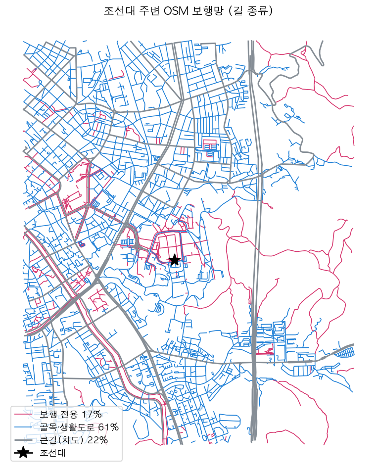
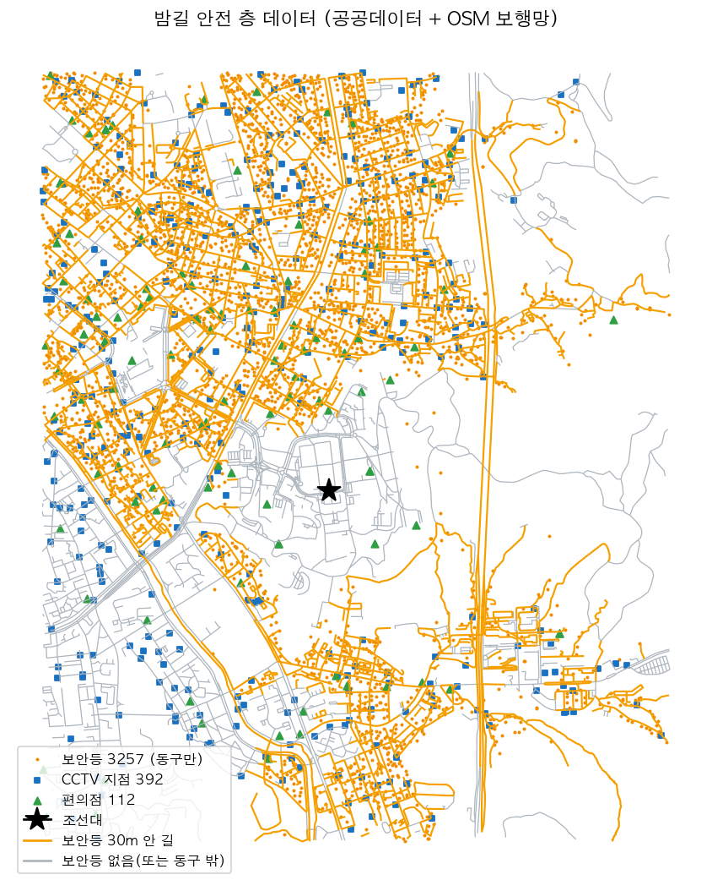

# 상황 맞춤 경로 도우미 — 1주차 데이터 확인 (조선대 주변)

- 확인일: 2026-10-28
- 범위: 위도 35.125~35.160, 경도 126.915~126.950. 조선대 중심 약 3.2 × 3.9 km로, 동구 대부분과 남구 일부(방림·양림)가 들어간다.
- 코드: `osm_check.py`(OSM 품질), `route_test.py`(경로 시험), `coverage.py`(공공데이터 겹치기). 원본은 `raw/`에 있다.

## 결론

| 항목 | 판정 | 한 줄 |
|---|---|---|
| OSM 보행망 | ✅ 쓸 만함 | 골목까지 촘촘하고 98%가 한 덩어리로 이어진다. 끊긴 조각 몇 개만 손보면 된다 |
| 보안등 | ✅ 동구는 충분 | 위경도가 있는 CSV, 로그인 불필요. 범위 안 3,257개, 동구 길의 72%가 30m 안에 보안등이 있다 |
| CCTV | ✅ 충분 | 광주 통합관제 CSV, 위경도 있음. 범위 안 392곳, 카메라 1,110대 |
| 편의점 | △ 대용 | 상가정보에 위치는 있지만 **24시간 여부가 없다** |
| 가로등(큰길) | ⚠️ 키 필요 | 파일이 없다. 행안부 공통POI(가로등) API만 있고 서비스 키가 필요하며 아직 확인 못 함 |
| 캠퍼스 안·남구 쪽 조명 | ❌ 빈 곳 | 학교 조명은 구청 자료에 없고, 남구 보안등은 동별 합계만 있다 |
| 지구대·안심귀갓길 | ⚠️ 없음 | 열쇠 없이 받을 파일이 없다. 근처 몇 곳은 손으로 좌표를 넣는 게 현실적이다 |

**→ 조선대 주변 동구에서는 "밤길 안전" 층을 1주차에 바로 만들 수 있습니다.**

## 1. OSM 보행망 품질

> OSM(오픈스트리트맵) 원본을 `curl`로 받아 osmnx로 분석했다.

| 지표 | 값 | 해석 |
|---|---|---|
| 보행망 총길이 | 253 km (노드 3,515, 링크 4,721) | 같은 범위의 차도망은 210 km. 보행 전용 길이 따로 들어 있다 |
| 길 종류 비율 | 골목·생활도로 61%, 큰길 22%, 보행 전용(인도·산책로·계단) 17% | 한국 OSM에서 걱정하던 골목 누락은 이 동네에서는 크지 않다 |
| 가장 큰 덩어리 | 노드의 98.2% | 23개 조각 중 작은 조각은 가장 가까운 큰 덩어리에 이어 붙여야 한다 |
| 무작위 300쌍 경로 | 우회율 중앙값 1.23, 상위 10% 1.54, 경로 없음 2.4% | 도심 보행망의 정상 범위(1.2~1.3) |
| 횡단보도 점 | 222개 | 큰길 건너는 지점 판단에 쓸 수 있다 |
| `lit`(조명) 태그 | 길이의 0.3% | **OSM으로는 조명 판단이 불가능하다** → 공공데이터 필요 |
| 인도(`sidewalk`) 태그 | 7.9% (큰길만 보면 18.9%) | 인도 유무는 거의 모른다 |
| 경사·폭·휠체어 태그 | 0~0.4% | 배리어프리 층은 OSM만으로는 안 된다 → 계단(16개)만 쓸 수 있고, 경사는 수치지형(DEM)이 필요하다 |
| OSM 안 가로등·CCTV·편의점 | 0 / 57 / 26 | 실제보다 훨씬 적다 → 공공데이터를 쓴다 |

## 2. 공공데이터

모두 data.go.kr에서 로그인 없이 받았고 이용 제한은 없다.

> 2026년 중반부터 제공기관 이름이 **"전남광주통합특별시"**로 바뀌었다. "광주광역시 동구"로 검색하면 안 나온다.

| 데이터 | 제공·기준일 | 형식 | 좌표 | 범위 안 |
|---|---|---|---|---|
| 전남광주통합특별시_동구_보안등정보 (전국보안등정보표준데이터 15017320) | 동구 건설과, 2025-12-23, 매년 | CSV (UTF-8) | 위경도 ✅ | 3,257개 (중복 좌표 제거 후) |
| 전남광주통합특별시_CCTV_20260630 (15084631) | 광주 CCTV통합관제센터, 2026-06-30, 반년 | CSV (**CP949**) | 위경도 ✅, 대수·설치연도 | 392곳, 카메라 1,110대 |
| 소상공인 상가(상권)정보_20260630 (15083033) | 소상공인시장진흥공단, 분기 | CSV (전국 ZIP 337MB) | 위경도 ✅ | 상가 7,423곳, 편의점 112, 약국 92 |
| 남구 보안등정보 | 남구 | CSV | 동별 합계 28행 | ❌ 점으로 못 씀 |
| 전국CCTV표준데이터 (15013094) | 행안부, 매일 | CSV (LOCALDATA) | 위경도 | 내려받기가 막혀(403) 확인 못 함. 구청 CCTV(어린이보호구역 등)까지 있을 가능성 |
| 행안부 공통POI(가로등 15150668·경찰 15150669) | 행안부 | OpenAPI | 위치정보 있다고 함 | **서비스 키 필요**, 확인 못 함 |
| 생활안전지도 API (safemap.go.kr) | 행안부 | API | – | 키 필요. 보안등·CCTV·여성밤길 층이 있다고 함, 확인 못 함 |

## 3. 보행망에 겹쳐 본 결과

> 길 조각마다 보안등 30m, CCTV·편의점 50m 안에 있는지 셌다. 보안등 파일이 동구 것뿐이라 동구 길만 따로 쟀다. 구 판정은 가장 가까운 상가의 구 이름으로 했다.

| | 동구 길 (204 km) | 동구 밖 길 (49 km, 주로 남구) |
|---|---|---|
| 보안등 30m 안 | **71.5%** | 7.1% (데이터 없음) |
| CCTV 50m 안 | 54.2% | 46.5% |
| 편의점 50m 안 | 22.5% | 10.2% |
| 셋 다 없는 길 | 18.8% | 46.8% |

동구 안을 길 종류별로 보면 보안등 30m 안 비율은 골목 77%, 큰길 70%, 보행 전용 44%다. 보행 전용 길이 낮은 이유는 산책로·캠퍼스 길이 많아서다.

- 길마다 점수 차이가 충분히 난다. 그래서 "어두운 길을 피하는 경로"가 최단 경로와 실제로 달라질 수 있다.
- **캠퍼스 안이 회색**이다. 학교 조명·CCTV는 구청·시 자료에 없기 때문이다. 학생 귀갓길의 핵심 구간이므로 따로 다뤄야 한다.

## 4. 빈 곳과 대책

| 빈 곳 | 영향 | 대책 (추천 순) |
|---|---|---|
| 큰길 가로등 | 큰길이 실제보다 어둡게 평가된다 | ① 큰길(primary·secondary·tertiary)은 가로등이 있다고 가정하는 규칙 ② data.go.kr 서비스 키를 받아 공통POI(가로등) 확인 |
| 캠퍼스 안 | 캠퍼스 길이 전부 "어두움"으로 나온다 | ① 캠퍼스를 별도 구역으로 두고 중립 점수 ② 조선대 시설과에 조명 위치 문의 ③ 팀이 직접 밤에 걸으며 기록 |
| 남구 쪽 보안등 | 남서쪽 길이 어둡게 나온다 | 1차 범위를 **동구로 한정**하고 남구는 "데이터 없음"으로 표시. 점수 0이 아니라 빈 값으로 처리 |
| 24시간 편의점 | 밤에 닫은 가게도 안전 점수를 받는다 | 프랜차이즈 편의점은 대부분 24시간이라고 가정하고 발표에 한계로 적는다 |
| 지구대·안심귀갓길 | 층에서 빠진다 | 근처 지구대 5~6곳은 손으로 좌표를 넣는다. 안심귀갓길은 동구청에 문의하거나 생활안전지도 키를 받는다 |
| OSM 작은 조각 | 경로의 2.4%가 실패한다 | 가장 가까운 큰 덩어리 노드에 이어 붙이는 전처리 |

## 다음 할 일 (1주차 나머지)

1. data.go.kr 회원가입 후 **서비스 키 신청**(공통POI 가로등·경찰). 팀원이 직접 해야 한다.
2. 보행망 + 보안등·CCTV·편의점을 길 조각 특징으로 붙여 저장한다(`coverage.py`를 확장).
3. 비용 함수 첫 버전과 최단 경로 대 밤길 경로를 비교한다. 예: 조선대 정문 → 산수동, 남광주역 → 조선대 후문.
